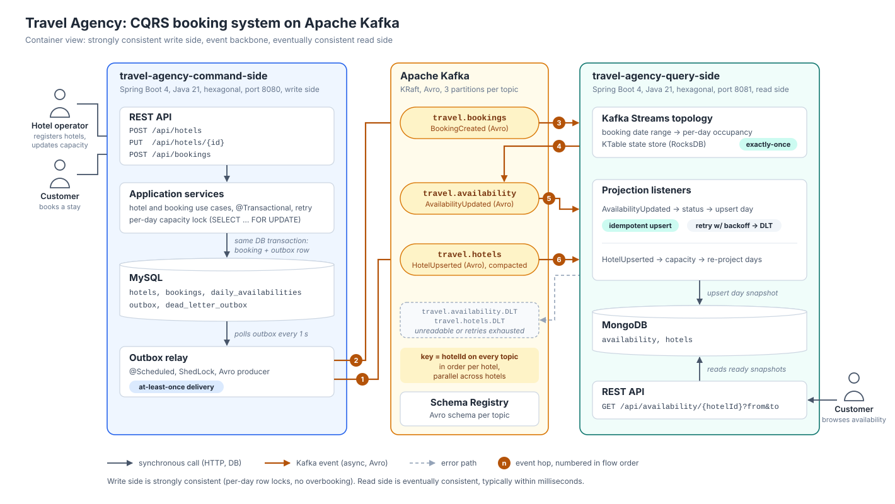
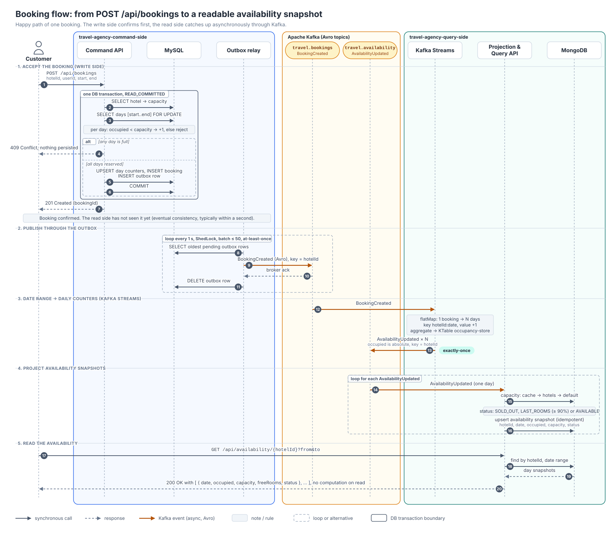
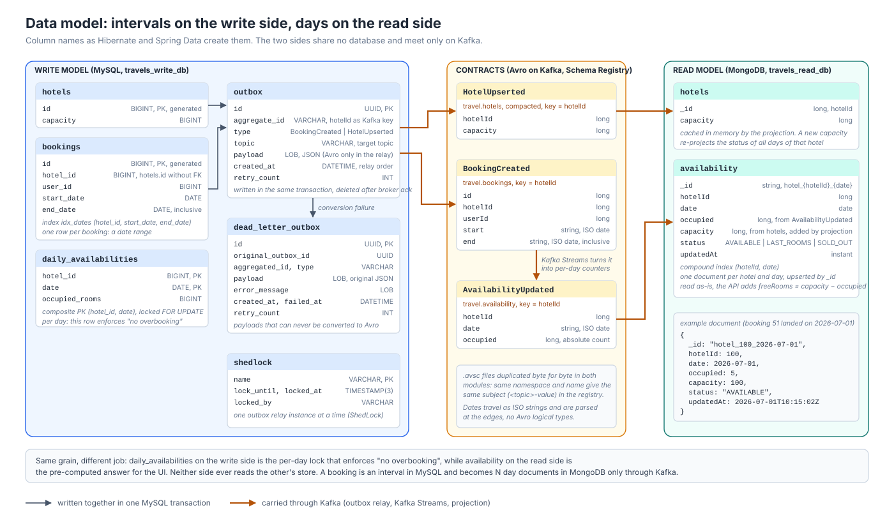
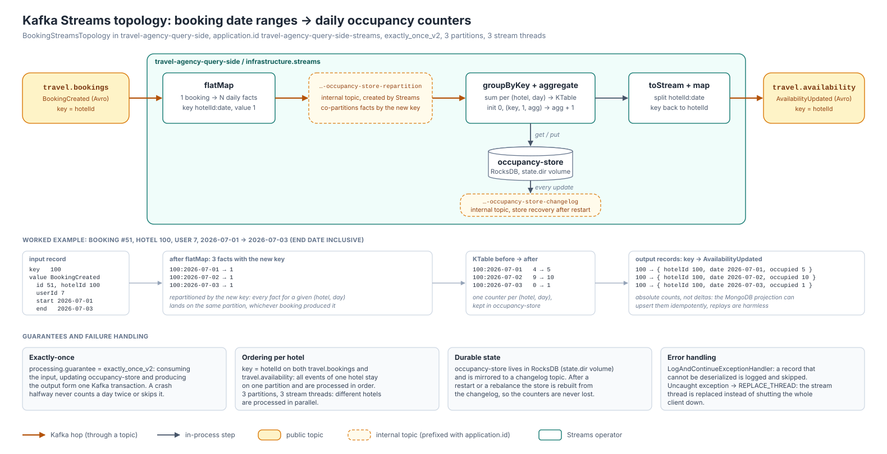

# Travel Agency - hotel booking with CQRS and Kafka

An event-driven hotel booking backend in Java 21 and Spring Boot 4, built with CQRS and hexagonal architecture.
Bookings go to a command side that prevents overbooking with row-level locks in MySQL, availability is served by a
query side backed by MongoDB, and the two services communicate only through Apache Kafka. I built it to learn Kafka
on something closer to a real system than a hello-world example, so it covers a transactional outbox, Kafka Streams
with a state store, Avro schemas kept in Schema Registry, and consumer error handling with retries and dead-letter
topics.

Core:<br>


Messaging:<br>


Databases:<br>


Testing:<br>


## Table of contents

- [The problem](#the-problem)
- [How it is built](#how-it-is-built)
- [Project structure](#project-structure)
- [How it works](#how-it-works)
- [Design decisions](#design-decisions)
- [Tests](#tests)
- [API](#api)
- [Running it locally](#running-it-locally)
- [What I would add next](#what-i-would-add-next)

## The problem

The project models a travel agency that sells hotel rooms through its website. Traffic on such a site is very uneven.
On an ordinary day outside the season there are a few dozen searches a minute and a handful of bookings a day. On
Black Friday or when the summer season opens, thousands of people browse the offer at the same time and dozens of them
try to book the same popular hotel within the same second. The agency earns most of its money during those peaks, so
the system has to behave correctly exactly then.

Two very different things happen on the site:

| | Booking a room (write) | Browsing the offer (read) |
|---|---|---|
| What happens | a customer books a stay | thousands of people ask whether a hotel is free on a given day |
| How often | relatively rarely | orders of magnitude more often |
| What matters most | correctness and consistency | speed and scale |
| Cost of a mistake | overbooking, which means lost money and an angry customer at the reception desk | a number that is out of date for a moment |
| Shape of the data | a booking covers a date range | availability is asked about a single day |

The most important rule is that a hotel can never sell more rooms on any day than it has. If both sides used one
database, the flood of reads would compete for resources with bookings that hold locks, and those locks would in turn
slow down browsing, right when the agency makes most of its money. That is why the system is split into a write side
and a read side (CQRS). Each of them is built for its own job, and they are connected by a stream of events.

The people using the system are customers who browse and book, hotel operators who register hotels and change their
capacity, and the marketing team, which wants a "last rooms" label on days that are almost sold out. Hotels are just
an example here. A car rental, a set of conference rooms or a doctor's calendar have the same problem of managing a
limited resource over time.

## How it is built

The system consists of two Spring Boot services:

- The **command side** accepts bookings. It checks the capacity of every day of the stay under row-level locks in
  MySQL and publishes events through a transactional outbox.
- The **query side** turns booking date ranges into per-day occupancy with Kafka Streams and keeps ready-to-read
  availability snapshots in MongoDB, so answering a query is a simple lookup.



## Project structure

```
travel-agency-cqrs-kafka
├── travel-agency-command-side     write side, port 8080, MySQL
│   └── src/main/java/io/github/debeee/travelagency/command
│       ├── domain                 Hotel, Booking, DailyAvailability (business rules)
│       ├── application            use cases, ports (in and out), services
│       ├── infrastructure         JPA adapters, outbox relay, Kafka producer, tx/retry decorators
│       └── presentation           REST controllers, DTOs, exception handler
├── travel-agency-query-side       read side, port 8081, MongoDB
│   └── src/main/java/io/github/debeee/travelagency/query
│       ├── domain                 Availability, AvailabilityStatusPolicy
│       ├── application            use cases, ports, services
│       ├── infrastructure         streams (topology), kafka (listeners, DLT), persistence, capacity
│       └── presentation           REST controller, DTOs, exception handler
├── docs                           diagrams (SVG)
├── postman                        Postman collection with the happy path through both services
├── docker-compose.yml             MySQL, MongoDB, Kafka, Schema Registry, Kafka UI and both services
└── .env.example                   configuration with demo values for local use
```

The two services are separate Maven projects and don't share any code. The only things they have in common are the
Kafka topics and the Avro schemas.

## How it works

1. `POST /api/bookings` runs in a single MySQL transaction. It locks the requested days, checks the capacity of each
   of them, increments the day counters and inserts the booking together with an outbox row. The client gets `201`,
   or `409` if any of the days is full.
2. The outbox relay publishes `HotelUpserted` and `BookingCreated` to Kafka as Avro records keyed by `hotelId` (hops 1
   and 2 in the architecture diagram).
3. Kafka Streams splits every booking into single days, keeps a running counter for each hotel and day, and emits
   `AvailabilityUpdated` with the current count (hops 3 and 4).
4. A listener upserts one MongoDB document per hotel and day with the occupancy, capacity and status (hop 5). When the
   capacity of a hotel changes, all its days are recalculated (hop 6).
5. `GET /api/availability/{hotelId}` returns these documents as they are, without any joins or calculations.

Every topic has 3 partitions and uses `hotelId` as the key.

| Topic | Written by | Read by | Avro value |
|---|---|---|---|
| `travel.bookings` | outbox relay | Kafka Streams | `BookingCreated` |
| `travel.hotels` | outbox relay | capacity listener | `HotelUpserted` |
| `travel.availability` | Kafka Streams | projection listener | `AvailabilityUpdated` |
| `travel.availability.DLT`, `travel.hotels.DLT` | consumer error handler | a person, in Kafka UI | the failed record |

`travel.hotels` is log-compacted, so Kafka keeps only the latest capacity of every hotel there. The dead-letter topics
get failed records unchanged, either after the retries or immediately when a record can't be deserialized.

The sequence diagram below follows a single booking from the HTTP request to the moment its days can be read from
MongoDB.



<details>
<summary><b>Data model</b> (MySQL tables, Avro schemas, MongoDB documents)</summary>

Both sides store the same facts in a different shape. MySQL keeps a booking as a date range plus one counter row per
hotel and day, the Avro records carry them between the services, and MongoDB keeps one ready-made document per hotel
and day.



</details>

## Design decisions

### 1. Locking per day instead of per hotel

The rule I have to protect works per hotel and per day. On every day of the stay the number of booked rooms has to
stay below the capacity. That's why the write side keeps one counter row per hotel and day in `daily_availabilities`
(the primary key is `(hotel_id, date)`), and a booking locks only the rows of the days it covers
([`JpaDailyAvailabilityRepository`][jpa-daily] uses `@Lock(PESSIMISTIC_WRITE)`). The check itself lives in the domain
model, in [`DailyAvailability.reserveOne`][daily-availability]. If any day is full, the whole transaction is rolled
back and the client gets `409 Conflict`.

Two details turned out to be less obvious than I expected:

- The transaction runs with `READ_COMMITTED` ([`TransactionalCreateBookingUseCase`][tx-booking]). With MySQL's
  default `REPEATABLE READ`, a range `SELECT ... FOR UPDATE` also takes gap locks, and those can block other
  transactions from inserting neighbouring days. That would bring back the contention that per-day locking was
  supposed to remove.
- `FOR UPDATE` can't lock a row that doesn't exist yet. When two transactions create the first booking for the same
  day at the same time, the primary key rejects the second insert. [`RetryingCreateBookingUseCase`][retry-booking]
  then retries the whole transaction (up to 3 attempts, 50 ms apart), and on the next attempt the row already exists
  and gets locked normally. The retry sits outside the transaction, so every attempt starts a new one.

### 2. Transactional outbox

The booking, the day counters and an `outbox` row are written in the same MySQL transaction, so the booking can't be
saved without its event. The outbox row holds a JSON payload, the target topic and `aggregate_id`, which is the hotel
id and later becomes the Kafka key. [`OutboxScheduler`][outbox] reads the table every second, oldest rows first and
at most 50 at a time. It converts each payload to Avro, sends it, waits for the broker to acknowledge it
(`send(...).get()`) and only then deletes the row, which gives at-least-once delivery. ShedLock makes sure only one
instance runs the relay when the service is scaled out.

I handle two kinds of failures differently:

| Failure | Example | What happens |
|---|---|---|
| Permanent | the payload can't be converted to Avro (broken JSON, unknown event type) | The row is moved to `dead_letter_outbox` right away and the relay goes on with the next one, so one bad message can't block the queue. |
| Transient | the broker is down or a request times out | The row stays in `outbox` and is retried on the next run for as long as it takes. The relay stops the current batch so that later events can't overtake it. After 5 failed attempts the log level goes up from WARN to ERROR. |

### 3. From date ranges to daily counters with Kafka Streams

The write side stores a booking as a date range, for example from 2030-07-01 to 2030-07-03, but customers ask about
single days. [`BookingStreamsTopology`][topology] translates one model into the other. `flatMap` turns a booking into
one record per day with the key `hotelId:date`, Kafka repartitions the records by that key, and
`groupByKey().aggregate()` adds them up in a KTable backed by a RocksDB state store and a changelog topic. At the end
`map` puts the `hotelId` key back and the result is written to `travel.availability`.

A few things worth knowing about this topology:

- It runs with `processing.guarantee=exactly_once_v2`, so reading the input, updating the store and writing the
  output are committed in one Kafka transaction.
- The output record contains the current count for the day (`occupied = 5`) instead of a "+1". Because of that, the
  projection can simply overwrite the document.
- After a restart the state store is rebuilt from the changelog. In Docker its directory is kept on a named volume,
  so the counters survive container restarts.



### 4. Idempotent projection and dead-letter topics

[`AvailabilityProjectionListener`][projection] turns each `AvailabilityUpdated` into a snapshot of one day with the
occupancy, capacity, number of free rooms and a status. The status comes from
[`AvailabilityStatusPolicy`][policy] and is `AVAILABLE`, `LAST_ROOMS` (from 90% occupancy, configurable) or
`SOLD_OUT`. The snapshot is upserted under a deterministic id `hotel_{hotelId}_{date}`
([`MongoAvailabilityRepositoryAdapter`][mongo-adapter]), so processing the same event twice leaves the document as it
was.

When processing fails ([`KafkaConsumerConfig`][consumer-config]), `DefaultErrorHandler` retries the record with
exponential backoff (1 s, 2 s, 4 s, 8 s and then every 10 s, for 30 s in total). If it still fails,
`DeadLetterPublishingRecoverer` writes it to `travel.availability.DLT` or `travel.hotels.DLT`, on the same partition
number. Records that can't be deserialized at all are caught by `ErrorHandlingDeserializer` and go to the DLT
immediately, so a single broken message doesn't block the partition.

The read side learns hotel capacities from the log-compacted `travel.hotels` topic and caches them in memory
([`MongoHotelCapacityProvider`][capacity-provider]). Sometimes a booking gets projected before its hotel arrives. In
that case a default capacity from the configuration is used, and [`HotelCapacityService`][capacity-service]
recalculates the status of all the hotel's days once `HotelUpserted` comes in. Capacity changes made with
`PUT /api/hotels/{id}` go through the same code.

### 5. `hotelId` as the key of every topic

The outbox `aggregate_id`, the key on `travel.bookings` and `travel.hotels`, and the key the topology uses when it
writes to `travel.availability` are all the hotel id. As a result, all events of one hotel land on the same partition
and are handled in order by one consumer, while different hotels are processed in parallel (there are 3 partitions
and 3 stream threads). Right now this keeps capacity updates in order. It also prepares the ground for cancellations,
because a `BookingCancelled` event could never be processed before the booking it cancels.

### 6. Hexagonal architecture

Both services are split into `domain`, `application` (use cases and ports), `infrastructure` (JPA, MongoDB, Kafka)
and `presentation` (REST). Dependencies only point inwards, following the dependency rule from Clean Architecture. The
domain doesn't depend on any other layer, the application layer only knows the domain, and the adapters depend on the
application ports, never the other way round. Every use case has its own input port, such as `CreateBookingUseCase`
or `UpdateHotelCapacityUseCase`, and the domain and application packages don't import anything from Spring or JPA.

The services are plain classes created with `new` in [`BeansConfiguration`][beans], and transactions and retries are
added around them by decorators. `TransactionalCreateBookingUseCase` wraps `BookingService`, and
`RetryingCreateBookingUseCase` wraps the transactional one. This lets me unit test the business logic with JUnit and
Mockito without starting Spring. Simple invariants, such as a positive capacity or a start date that isn't after the
end date, are checked in the constructors of the domain records.

## Tests

The project has 154 tests. Unit tests (classes ending with `Test`, run by Surefire) don't need Docker. Integration
tests (ending with `IT`, run by Failsafe) start real MySQL, Kafka and MongoDB containers with Testcontainers.

| Level | What is tested | Tools |
|---|---|---|
| Domain and application | the per-day capacity rule, status thresholds, the order of calls in the services (reserve the days, save the booking, write the outbox row) and that nothing is saved when a booking is rejected | JUnit 5, BDDMockito, AssertJ |
| Infrastructure units | the outbox relay (a bad payload goes to the dead-letter table, a broker failure keeps the row and stops the batch, the log level goes up), DLT routing and the capacity cache | Mockito, `OutputCaptureExtension` |
| Kafka Streams | one record per day, overlapping bookings adding up, separate counters for each hotel and the content of the state store | `TopologyTestDriver`, `mock://` Schema Registry |
| Web layer | request validation and the HTTP status returned for each error (400, 404, 405, 409, 415, 500) | `@WebMvcTest` |
| Persistence | real row locks in MySQL, where one of two transactions fighting for the last room gets an `OverbookingException` and two concurrent first inserts of the same day end with a `DataIntegrityViolationException`, plus upsert idempotency and date range queries in MongoDB | `@DataJpaTest`, `@DataMongoTest`, Testcontainers |
| End-to-end | on the command side, the whole way from the HTTP request through MySQL and the outbox to Kafka, including 10 concurrent clients competing for 3 rooms. On the query side, the way from Kafka through Streams and MongoDB to the HTTP response, capacity recalculation, duplicate delivery and broken records going to the DLT without blocking the partition | `@SpringBootTest`, Testcontainers, Awaitility |

```bash
cd travel-agency-command-side   # or travel-agency-query-side
./mvnw test                     # unit tests only
./mvnw verify                   # unit and integration tests, Docker has to be running
```

## API

| Service | Endpoint | Body or parameters | Success response |
|---|---|---|---|
| command `:8080` | `POST /api/hotels` | `capacity` | `201` with `hotelId` |
| command `:8080` | `PUT /api/hotels/{hotelId}` | `capacity` | `200` with `hotelId` and `capacity` |
| command `:8080` | `POST /api/bookings` | `hotelId`, `userId`, `start`, `end` | `201` with `bookingId` |
| query `:8081` | `GET /api/availability/{hotelId}` | optional `from` and `to`, always given together | `200` with a list of days, each with `hotelId`, `date`, `occupied`, `capacity`, `freeRooms` and `status` |

You can find full requests and responses in [Try it](#try-it). Dates use the ISO format (`2030-07-01`). The end date
of a booking is inclusive and dates can't be in the past. Errors look like `{"message": "...", "timestamp": "..."}`,
and validation errors also contain a `validationErrors` map with a message for each field. The command side returns
`400` for invalid input, `404` when the hotel doesn't exist and `409` when one of the days is full or a concurrent
booking still conflicts after the retries.

## Running it locally

You only need Docker with Docker Compose. Java 21 is required only if you want to run the tests.

```bash
git clone https://github.com/deBeee/travel-agency-cqrs-kafka.git
cd travel-agency-cqrs-kafka
cp .env.example .env          # demo values for local use, nothing to fill in
docker compose up -d --build  # the first build takes a few minutes
docker compose ps             # wait until both services are "healthy"
```

| What | Where |
|---|---|
| Command side (write API) | http://localhost:8080 |
| Query side (read API) | http://localhost:8081 |
| Kafka UI with topics, Avro messages and dead-letter topics | http://localhost:8100 |
| Schema Registry | http://localhost:8200/subjects |

MySQL listens on port `3307`, MongoDB on `27018` and Kafka on `9092`. To stop everything and delete the data, run
`docker compose down -v`.

### Try it

The ids in the comments assume an empty database, so if yours are different, use the ones you get back. The dates
have to be today or later.

```bash
# 1. Register a hotel with a single room
curl -s -X POST localhost:8080/api/hotels \
  -H 'Content-Type: application/json' -d '{"capacity": 1}'
# {"hotelId":1}

# 2. Book 1 to 3 July (the end date is inclusive, so three days are taken)
curl -s -X POST localhost:8080/api/bookings \
  -H 'Content-Type: application/json' \
  -d '{"hotelId": 1, "userId": 7, "start": "2030-07-01", "end": "2030-07-03"}'
# {"bookingId":1}

# 3. Try to book 3 to 5 July. 3 July is already full, so the whole booking is rejected
curl -s -X POST localhost:8080/api/bookings \
  -H 'Content-Type: application/json' \
  -d '{"hotelId": 1, "userId": 8, "start": "2030-07-03", "end": "2030-07-05"}'
# HTTP 409 {"message":"Hotel 1 overbooked on 2030-07-03. Capacity: 1, occupied: 1", ...}

# 4. Ask the query side about availability
curl -s 'localhost:8081/api/availability/1?from=2030-07-01&to=2030-07-03'
```

```json
[
  {"hotelId": 1, "date": "2030-07-01", "occupied": 1, "capacity": 1, "freeRooms": 0, "status": "SOLD_OUT"},
  {"hotelId": 1, "date": "2030-07-02", "occupied": 1, "capacity": 1, "freeRooms": 0, "status": "SOLD_OUT"},
  {"hotelId": 1, "date": "2030-07-03", "occupied": 1, "capacity": 1, "freeRooms": 0, "status": "SOLD_OUT"}
]
```

```bash
# 5. Raise the capacity to 10. The query side recalculates the status of every day of the hotel
curl -s -X PUT localhost:8080/api/hotels/1 \
  -H 'Content-Type: application/json' -d '{"capacity": 10}'
# {"hotelId":1,"capacity":10}
# The same GET as in step 4 now returns capacity 10, freeRooms 9 and status AVAILABLE
```

[jpa-daily]: travel-agency-command-side/src/main/java/io/github/debeee/travelagency/command/infrastructure/persistence/repository/JpaDailyAvailabilityRepository.java
[daily-availability]: travel-agency-command-side/src/main/java/io/github/debeee/travelagency/command/domain/model/DailyAvailability.java
[tx-booking]: travel-agency-command-side/src/main/java/io/github/debeee/travelagency/command/infrastructure/tx/TransactionalCreateBookingUseCase.java
[retry-booking]: travel-agency-command-side/src/main/java/io/github/debeee/travelagency/command/infrastructure/tx/RetryingCreateBookingUseCase.java
[outbox]: travel-agency-command-side/src/main/java/io/github/debeee/travelagency/command/infrastructure/kafka/outbox/OutboxScheduler.java
[beans]: travel-agency-command-side/src/main/java/io/github/debeee/travelagency/command/infrastructure/configuration/BeansConfiguration.java
[topology]: travel-agency-query-side/src/main/java/io/github/debeee/travelagency/query/infrastructure/streams/BookingStreamsTopology.java
[projection]: travel-agency-query-side/src/main/java/io/github/debeee/travelagency/query/infrastructure/kafka/listener/AvailabilityProjectionListener.java
[policy]: travel-agency-query-side/src/main/java/io/github/debeee/travelagency/query/domain/policy/AvailabilityStatusPolicy.java
[mongo-adapter]: travel-agency-query-side/src/main/java/io/github/debeee/travelagency/query/infrastructure/persistence/adapter/MongoAvailabilityRepositoryAdapter.java
[consumer-config]: travel-agency-query-side/src/main/java/io/github/debeee/travelagency/query/infrastructure/kafka/config/KafkaConsumerConfig.java
[capacity-provider]: travel-agency-query-side/src/main/java/io/github/debeee/travelagency/query/infrastructure/capacity/MongoHotelCapacityProvider.java
[capacity-service]: travel-agency-query-side/src/main/java/io/github/debeee/travelagency/query/application/service/HotelCapacityService.java
